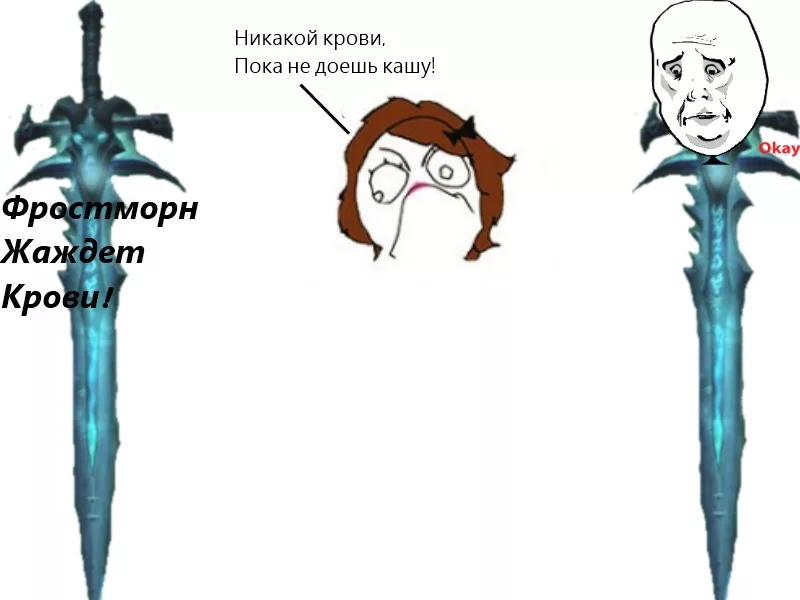

# Бурмлда RPG 🗡️

Маленькая консольная RPG на чистом Python — без зависимостей, только стандартная библиотека.



## Как играть

```bash
python main.py
```

1. Выбери одного из пяти героев:

| Герой | Класс | Пол | HP | Урон | Броня |
|-------|-------|-----|----|------|-------|
| Алексей | Воин | женщина | 100 | 15 | 10 |
| Гриша | Разбойник | мужчина | 80 | 20 | 5 |
| Аня | Маг | женщина | 60 | 30 | 2 |
| Игорь | Воин | мужчина | 120 | 12 | 14 |
| Соня | Разбойник | женщина | 75 | 22 | 4 |

2. Сражайся со случайным соперником: каждый удар — бросок кубика **d20**
   - **1** — промах
   - **20** — критический удар (урон ×3)
   - иначе урон = `урон × кубик / 10`, броня поглощает часть
3. Победил — открывай сундук. Внутри ждёт **Фростморн** и диалог у ледяного постамента (сцена Артаса и Мурадина из Warcraft III)
4. После диалога откроется картинка 🎁

## Файлы

- `main.py` — вся игра
- `i.png` — картинка, которая открывается после диалога (должна лежать рядом с кодом)

## Требования

- Python 3.6+
- Windows (картинка открывается через `os.startfile`; бой и диалог работают везде)

## Лицензия

MIT
